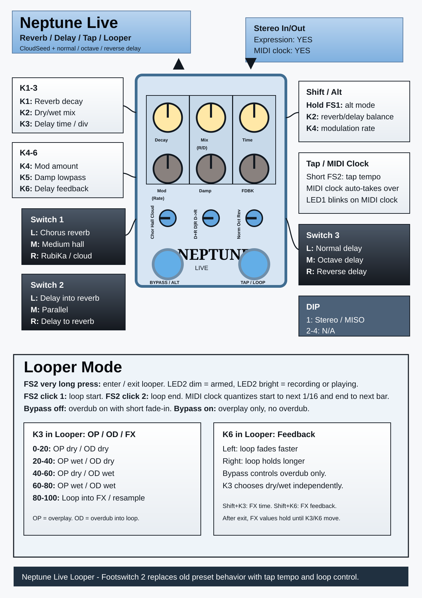

# Neptune

Neptune is a stereo reverb/delay pedal for Funbox. Reverb is based on CloudSeed; delay modes are normal, octave, and reverse. This version replaces the old preset footswitch behavior with tap tempo, MIDI clock, and a live looper.



## Main Controls

| Control | Normal mode |
| --- | --- |
| Knob 1 | Reverb decay. |
| Knob 2 | Dry/wet mix. Shift: reverb/delay balance. |
| Knob 3 | Delay time. With tap/MIDI clock active: tempo division. |
| Knob 4 | Reverb modulation amount. Shift: modulation rate. |
| Knob 5 | Reverb lowpass/damping. |
| Knob 6 | Delay feedback. |
| Switch 1 | Reverb mode: left chorus, middle medium hall, right RubiKa/cloud. |
| Switch 2 | Routing: left delay into reverb, middle parallel, right delay into reverb only. |
| Switch 3 | Delay mode: left normal, middle octave, right reverse. |
| DIP 1 | Stereo input when on; mono in/stereo out when off. |
| Footswitch 1 | Bypass. Hold while active for shift/alternate controls. |
| Footswitch 2 | Tap tempo in normal mode. Very long press enters/exits looper mode. |
| LED 1 | Effect on/off, shift state, and MIDI clock debug blink. |
| LED 2 | Tap/MIDI clock pulse, looper state. |

## Tempo

Neptune starts in free knob-time mode. Tap or MIDI clock can take over at any time.

| Source | Behavior |
| --- | --- |
| Knob | Free delay time from Knob 3. |
| Tap | Short Footswitch 2 clicks set tap tempo. Tap temporarily protects against immediate MIDI takeover. |
| MIDI clock | Incoming MIDI clock can take over automatically. MIDI clock LED feedback blinks on LED1. |

### Knob 3 Tempo Divisions

When tap or MIDI clock is active, Knob 3 selects:

`1/16`, `1/8`, `1/8 triplet`, `dotted 1/8`, `1/4 triplet`, `1/4`, `dotted 1/4`, `1/2`, `1 bar`, `2 bars`, `4 bars`

## Looper

Very long press on Footswitch 2 enters looper mode. LED2 is dim while armed. First short tap sets loop start; second short tap sets loop end. LED2 is bright when recording or playing.

Very long press on Footswitch 2 exits looper mode, stops the loop, and returns to auto tap/MIDI behavior.

| Control in looper mode | Function |
| --- | --- |
| Knob 3 | Neptune FX time / tempo division. Shift: looper routing, 5 zones. |
| Knob 6 | Neptune FX feedback. Shift: looper feedback/decay. |
| Footswitch 1 / bypass | Effect active = overdub enabled. Bypass = loop plays without overdub. |
| Footswitch 2 short click | Start/end loop. |
| Footswitch 2 very long press | Enter/exit looper mode. |

### Knob 3 Looper Routing

| Zone | Mode | Meaning |
| --- | --- | --- |
| 0-20% | OP dry / OD dry | Dry live overplay. Dry signal is overdubbed. |
| 20-40% | OP wet / OD dry | Wet live overplay. Dry signal is overdubbed. |
| 40-60% | OP dry / OD wet | Dry live overplay. Wet Neptune signal is overdubbed. |
| 60-80% | OP wet / OD wet | Wet live overplay. Wet Neptune signal is overdubbed. |
| 80-100% | Loop Into FX / Resample | Loop playback goes through Neptune FX. With overdub enabled, the processed result is written back into the loop. |

OP means overplay: what you play live over the loop. OD means overdub: what gets written into the loop when overdub is enabled. In looper mode, bypass controls overdub on/off only; Shift + K3 chooses dry/wet or resample behavior independently. Overdub fades in briefly when enabled.

Hold Footswitch 1 in looper mode for looper controls:

| Shift control | Function |
| --- | --- |
| Shift + Knob 3 | Looper routing, 5 zones. |
| Shift + Knob 6 | Looper feedback/decay. |

The normal Knob 3/6 values keep controlling Neptune FX time/feedback during looper mode and after leaving it. Looper routing and looper feedback are remembered separately while Neptune is running.

Leaving looper mode uses jump behavior: normal Knob 3 and Knob 6 immediately follow the physical pot positions again.

### MIDI Quantized Looping

If MIDI clock is present:

| Tap | Quantization |
| --- | --- |
| First looper tap | Starts on the next 1/16 note. |
| Second looper tap | Ends on the next bar line. |

Without MIDI clock, start/end are immediate.

## Trails

Bypass keeps true trails. Delay and reverb continue with no new input, and their tails remain audible. This avoids frozen-buffer bursts when the effect is switched back on.

## Expression

1. Plug a passive expression pedal into the 1/8 inch TRS expression jack.
2. Hold both footswitches for more than 0.5 seconds and less than 2 seconds to enter expression set mode.
3. Move the expression pedal to heel and move any knobs to the desired heel values.
4. Move the expression pedal to toe and move any knobs to the desired toe values.
5. Hold both footswitches again to exit expression set mode and activate expression for the moved knobs.
6. Hold both footswitches for 2 seconds or more to clear expression assignments.

The expression input needs the full pedal range to detect heel/toe reliably.

## MIDI Reference

| Control | MIDI CC | Value |
| --- | --- | --- |
| Knob 1 | 14 | 0-127 |
| Knob 2 | 15 | 0-127 |
| Knob 3 | 16 | 0-127 |
| Knob 4 | 17 | 0-127 |
| Knob 5 | 18 | 0-127 |
| Knob 6 | 19 | 0-127 |

## Build

Neptune runs in SRAM memory on the Daisy Seed and should be loaded through the bootloader. Build CloudSeed first if needed.

```bash
cd /i/Daisy/FunBox/FunBox/softwaree/Neptune/neptune
make
make program-dfu
```
